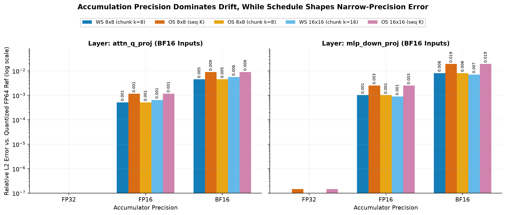
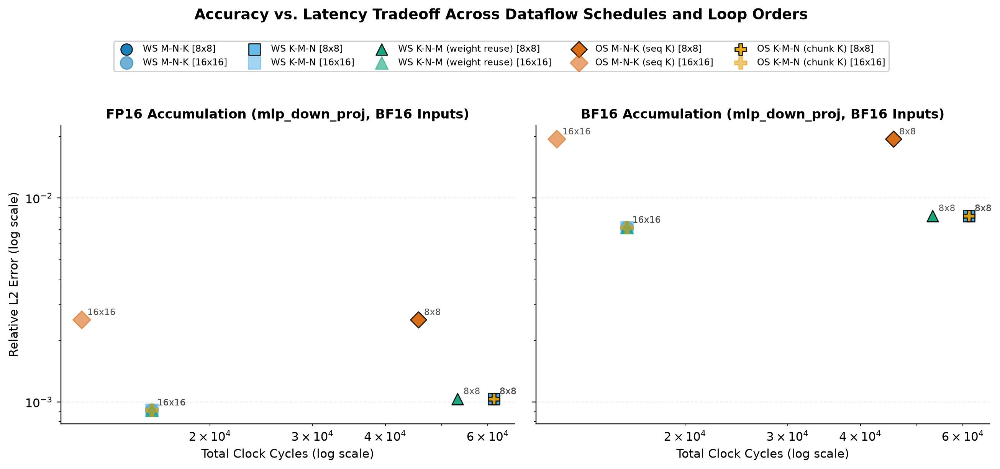
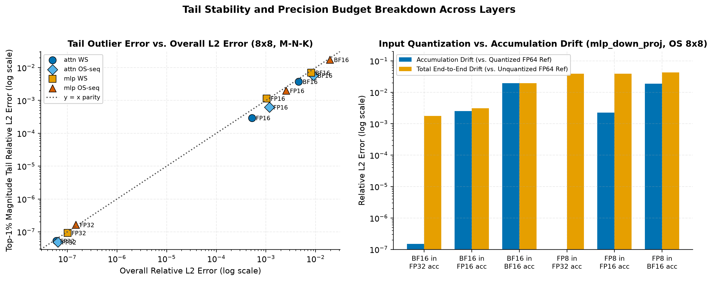

# SystolicDrift: Measuring Numerical Drift Across Systolic Dataflows, Tiling Schedules, and Accumulator Precisions

## 1. Problem and Hypothesis

Floating-point addition is non-associative. When matrix multiplication $C = A \cdot B$ executes on a 2D systolic array, the hardware geometry, dataflow mapping, and loop traversal order determine the exact parenthesization of partial-sum reductions along the $K$ axis. Under narrow accumulator precisions such as `BF16` and `FP16`, different addition trees can diverge measurably even when every schedule consumes bit-identical quantized inputs.

I tested three hypotheses on real transformer activations and weights:

1. **Accumulator width dominates total drift, while schedule controls narrow-precision variance.** Moving from `FP32` to `FP16` or `BF16` accumulators increases relative L2 error by orders of magnitude, and within narrow accumulators, sequential accumulation over deep $K$ dimensions drifts more than chunked partial-sum reduction.
2. **Loop traversal order creates an accuracy-latency tradeoff.** Keeping outputs stationary across all $K$-tiles (`OS M-N-K`) minimizes drain cycles, but forces long sequential accumulation chains. Reordering loops for weight reuse (`WS K-N-M`) or chunked K-reduction (`OS K-M-N`) trades off preload/drain cycles against numerical stability.
3. **Activation outliers amplify absolute tail errors, while narrow input quantization shifts the precision budget.** Real transformer layers exhibit high crest factors (`max(|x|) / rms(x) > 16`), placing worst-case absolute errors inside the top-1% magnitude tail, while `FP8 E4M3` input quantization can dominate accumulation drift unless accumulator width drops to `BF16`.

---

## 2. Simulator and Tiling Model

**SystolicDrift** implements a cycle-stepped 2D `(R, C)` processing element (PE) grid in `src/systolic_drift/simulator.py` with explicit IEEE round-to-nearest-even (RNE) casting in `src/systolic_drift/dtypes.py`:

- **Input quantization (`quantize_tensor`)**: Input matrices $A$ and $B$ are quantized once per input precision (`bf16`, `fp8_e4m3`, `fp8_e5m2`, `fp16`, `fp32`, `fp64`) so every hardware schedule processes identical operand values.
- **Weight-Stationary (`weight_stationary`)**: Each $(K_t \le R, N_t \le C)$ weight tile is stationary in the PE grid (`preload_cycles = R` whenever `(k_idx, n_idx)` changes). Skewed activation rows stream West to East while partial sums propagate North to South starting from `0` at row `0`. Each $K$-tile produces a partial sum of chunk size $K_t$ that is accumulated into the output buffer (`ws_chunked_k8` or `ws_chunked_k16`).
- **Output-Stationary (`output_stationary`)**: Each $(M_t \le R, N_t \le C)$ output tile resides in the PE accumulators while activations stream East and weights stream South.
  - Under `M-N-K` loop order, $(m, n)$ output tiles remain stationary across all $K$-tiles (`os_seq_k`), draining once per output tile (`drain_cycles = R`) and executing pure sequential accumulation over $k = 0 \dots K-1$.
  - Under `K-M-N` or `K-N-M` loop order, PE accumulators reset between $K$-tiles (`os_chunked_k8` or `os_chunked_k16`), draining after every tile and reducing partial sums into the output buffer.

---

## 3. Experimental Setup

- **Hardware and Runtime**: Apple M1 Mac (8 GB RAM), Python 3.12.15, NumPy, PyTorch, HuggingFace Transformers. All 144 ablation runs finished in **29.34 seconds**.
- **Model and Layers**: `HuggingFaceTB/SmolLM2-135M`, middle transformer block (layer 15), `seq_len = 16`, sliced to `(M, K, N) = (16, 256, 256)` (`1,048,576` MACs per matmul):
  - `attn_q_proj` (`model.layers.15.self_attn.q_proj`): `act_rms = 0.3419`, `act_max_abs = 6.8957` (**crest factor = 20.17**), `ref_out_rms = 1.0072`, `ref_out_max_abs = 8.8812`.
  - `mlp_down_proj` (`model.layers.15.mlp.down_proj`): `act_rms = 0.1390`, `act_max_abs = 2.3013` (**crest factor = 16.56**), `ref_out_rms = 0.3894`, `ref_out_max_abs = 2.2584`.
- **Ablation Grid (144 total runs)**:
  - **Array sizes**: `8x8`, `16x16`
  - **Dataflows**: `weight_stationary`, `output_stationary`
  - **Loop orders**: `M-N-K`, `K-M-N`, `K-N-M`
  - **Input precisions**: `bf16`, `fp8_e4m3`
  - **Accumulator precisions**: `fp32`, `fp16`, `bf16`
- **Metrics**: Evaluated against both the quantized-input `FP64` reference (isolating pure accumulation and schedule drift) and the unquantized `FP64` reference (end-to-end drift), recording cosine similarity, relative L2 error, max absolute error, top-1% highest-magnitude tail error, non-finite counts, utilization, and clock cycles.

---

## 4. Results and Outlier Analysis

### 4.1 Accumulator Precision and Addition-Tree Geometry

Across all 144 runs, **zero non-finite values** (`NaN` or `Inf`) occurred because `SmolLM2-135M` layer-15 partial sums remain well below the `FP16` overflow limit (`65,504`). Mean and worst-case relative L2 errors across accumulator precisions are summarized below:

| Accumulator Precision | Mean Rel L2 Error | Max Rel L2 Error | Scale Relative to FP32 |
| :--- | :--- | :--- | :--- |
| `fp32` | `4.00e-8` | `1.49e-7` | `1.0x` |
| `fp16` | `9.29e-4` | `2.53e-3` | `~23,200x` |
| `bf16` | `7.59e-3` | `1.94e-2` | `~189,700x` |



Within narrow accumulators (`FP16` and `BF16`), the addition tree induces a **2.0x to 2.7x error spread**:

- On `attn_q_proj` (`BF16` inputs, `BF16` accumulation), `WS 8x8` (`ws_chunked_k8`) and `OS 8x8 K-M-N` (`os_chunked_k8`) achieve `rel_l2 = 0.00456`, compared to `0.00564` on `16x16` chunked schedules and `0.00907` (**1.99x higher**) on sequential `OS M-N-K` (`os_seq_k`).
- On `mlp_down_proj` (`BF16` inputs, `BF16` accumulation), `WS 16x16` achieves `rel_l2 = 0.00718` (`~0.008` on `8x8`), while sequential `OS M-N-K` (`os_seq_k`) reaches **`rel_l2 = 0.01945`** (**2.71x higher** than `WS 16x16`).
- **Why sequential K-reduction drifts more**: Under `OS M-N-K`, all `K = 256` products accumulate sequentially into a single register, causing worst-case linear rounding accumulation and partial-sum absorption when small terms meet larger running sums. Chunked schedules (`k=8` or `k=16`) reset PE partial sums per tile and combine shorter blocks, bounding rounding accumulation.

### 4.2 Latency vs. Accuracy Pareto Tradeoff



Schedule selection creates a clear hardware tradeoff:

- **Fastest schedule (`OS 16x16 M-N-K`)**: Finishes in **`12,032` cycles** (`11,776` wavefront + `256` drain cycles, `34.0%` PE utilization) by holding outputs stationary across all 16 $K$-tiles, but sits at the worst-error corner (`rel_l2 = 0.00907` on `attn_q_proj` and `0.01945` on `mlp_down_proj` in `BF16` accumulation).
- **Pareto-efficient `WS 16x16`**: Cuts `BF16` accumulation error by **2.0x to 2.7x** (`0.00564` on `attn_q_proj`, `0.00718` on `mlp_down_proj`) at `15,872` cycles (**1.32x** cycle overhead relative to `OS 16x16 M-N-K`).
- **Loop-order weight reuse on `8x8` (`WS 8x8 K-N-M`)**: Because `M = 16` splits into two `8`-row tiles, `K-N-M` keeps each weight tile loaded across both $M$-tiles, cutting `weight_loads` from `2,048` to `1,024` and reducing total cycles from `61,440` (`WS 8x8 M-N-K`) to `53,248` while preserving the lower `ws_chunked_k8` drift (`0.00456` on `attn_q_proj`). Note that on `16x16`, `M = 16` fits in a single $M$-tile, so `WS 16x16` yields identical cycle counts across `M-N-K`, `K-M-N`, and `K-N-M`.

### 4.3 Outlier Tail Behavior and Input Quantization Budget



- **Top-1% Tail Elements**: Across `8x8` `M-N-K` configurations (left panel), `top1p_rel_l2` tracks on or slightly below the `y = x` parity line. For `OS 16x16 M-N-K` (`attn_q_proj`, `BF16` inputs, `BF16` acc), `rel_l2_error = 0.00907` while `top1p_rel_l2 = 0.00578`. However, **`top1p_max_abs = 0.07624` equals the global `max_abs_error` (`0.07624`)**, confirming that the largest absolute rounding deviations occur squarely on the high-magnitude activation/output tail even though their larger denominators keep relative L2 error slightly lower.
- **Input Quantization vs. Accumulation Drift**: The right panel separates pure accumulation drift (blue, vs. quantized `FP64` reference) from total end-to-end drift (orange, vs. unquantized `FP64` reference) on `mlp_down_proj` (`OS 8x8 M-N-K`):
  - With `BF16` inputs + `FP32` accumulation, accumulation drift is negligible (`~1.5e-7`) and `BF16` input quantization (`~1.8e-3`) accounts for virtually all end-to-end error.
  - With `BF16` inputs + `BF16` accumulation, accumulation drift (`0.01945`) overwhelms input quantization and determines the total error (`~0.0195`).
  - With `FP8 E4M3` inputs, input quantization raises total end-to-end drift to `~0.038` under `FP32`/`FP16` accumulators, while `BF16` accumulation adds substantial compounding error (`~0.019` accumulation drift on top of `FP8` quantization).

---

## 5. Limitations

- **Layer and Sequence Scope**: Experiments evaluate two representative middle-layer projections (`attn_q_proj` and `mlp_down_proj`) from `SmolLM2-135M` with `seq_len = 16` and sliced inner/output dimensions `(16, 256, 256)`. Larger hidden dimensions ($K \ge 4096$) and deeper models with stronger activation spikes (`> 65,504` intermediate products) would amplify sequential `BF16` drift and expose `FP16` overflow regimes not triggered here.
- **No Inter-Layer Error Propagation**: Each matmul is evaluated independently rather than feeding drifted layer outputs forward through subsequent normalization and attention blocks.
- **Idealized SRAM and Interconnect**: Cycle accounting models PE wavefront latency, weight preload cycles (`R` per weight tile miss), and stationary accumulator drain cycles (`R` per drain) without modeling off-chip DRAM bandwidth contention or double-buffered preload overlap.

---

## 6. Reproducibility

Run the full unit test suite (`47` tests, offline deterministic synthetic fixtures included):

```bash
PYTHONPATH=src pytest -v
```

Run the 144-config ablation sweep and regenerate all figures:

```bash
python scripts/run_experiments.py
python scripts/make_charts.py
```

For completely offline execution without downloading `HuggingFaceTB/SmolLM2-135M`:

```bash
python scripts/run_experiments.py --source synthetic
python scripts/make_charts.py
```
